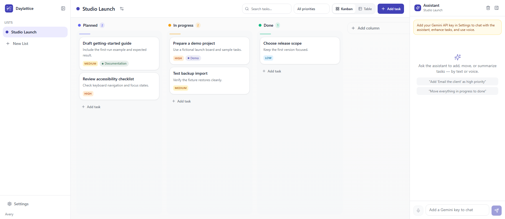

# Daylattice

**Open-source, local-first AI task manager for desktop.** Organize tasks on a Kanban board or in a table. Add an optional Gemini assistant for chat, task suggestions, and voice commands.



## What it does

- Create task lists with sections, labels, priorities, and due dates. Switch between Kanban and table views.
- Store tasks, list context, and assistant history in a local SQLite database. Task management works offline.
- Enable the assistant with your own Gemini API key. Use chat or voice to organize a list, or ask for suggested task details.
- Connect the optional WhatsApp sidecar to a linked device and choose the full international control number in Settings. Remote commands are disabled until that number is set.
- Export and restore versioned backups. Archives contain task data and assistant history. Keep them somewhere private.

## Run from source

Install Node.js 22 or newer, pnpm 10, a current stable Rust toolchain, and the [Tauri prerequisites](https://v2.tauri.app/start/prerequisites/) for your desktop platform. Windows builds need Microsoft C++ Build Tools and WebView2.

```sh
git clone https://github.com/MusaBukhari237/daylattice.git
cd daylattice
pnpm install --frozen-lockfile
pnpm sidecar:build
pnpm tauri dev
```

Create a local profile and a list. The board works without filling in any integration settings. To use the assistant, enter a [Gemini API key](https://aistudio.google.com/apikey) in **Settings**. Enable launch at sign-in there if you want it.

| Command | Result |
| --- | --- |
| `pnpm build` | Type-check React and build the frontend |
| `pnpm lint` | Lint the frontend |
| `cargo test --locked --manifest-path src-tauri/Cargo.toml --lib` | Run native tests after building the sidecar |
| `pnpm tauri build` | Build a native desktop bundle after building the sidecar |

If Tauri reports a missing sidecar, run `pnpm sidecar:build` on the same platform and architecture you plan to build for. If the Rust build reports a linker error, check the platform requirements before retrying.

## Data and integrations

Tasks and profiles stay in the app’s local SQLite database. Gemini receives the prompts, context, and any audio you submit to AI features. The optional WhatsApp integration connects through Baileys and uses a local session directory. The Gemini key is stored in the operating system’s keychain. Backup files are unencrypted archives and omit keychain credentials and WhatsApp session files. Details and reporting instructions are in [Security](SECURITY.md).

## Sponsors

Supported by [LeadCeleris](https://www.leadceleris.com/) and [AIFFICIENTO](https://www.aifficiento.biz/).

## Contributing

See [CONTRIBUTING.md](CONTRIBUTING.md) for checks and contribution guidance. Daylattice is licensed under the [MIT license](LICENSE).
